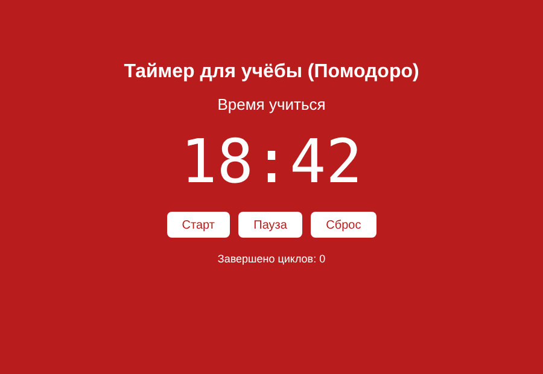

# Таймер для учёбы (Помодоро)

Таймер по методу Помодоро: 25 минут учёбы, затем 5 минут перерыва.

Демо: https://mustafamashhady2.github.io/pomodoro/

## Задача
Сделать таймер, который помогает учиться с перерывами и считает завершённые циклы.

## Что сделано
- кнопки «Старт», «Пауза», «Сброс»
- обратный отсчёт в формате мм:сс
- после окончания учёбы таймер сам переключается на перерыв и меняет цвет фона
- счётчик завершённых циклов

## Инструменты
HTML, CSS, JavaScript

## Контекст
Учебный проект, делал один.
